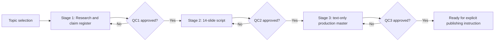

# Editorial workflow and human gates

## Reusable stages
**Discovery (optional):** Category/topic shortlist → relevance and evidence screen → owner topic QC. This is **not** a company case research approval.

### Sourcebyjay company cases

Stage 1 = official/independent/competitor sources, founder and backer map, decision dilemma, before-after and rival explanations, source register, open questions, 2–4 provisional angles. **Stop at QC1.**

Stage 2 = approved 14-slide structure, strong transitions, 3 visible fields for final handoff, internal evidence IDs and separate review. **Stop at QC2.**

Stage 3 = owner-approved copy packaged as **one Markdown final text master** with exactly Headline / Description / Data on each slide. No automatic images, no ZIP, no mockups. **Stop at QC3.** After QC3, do not auto-publish.

### Other formats
PGS: persona QC → topic/hook QC → evidence/mentor review → script QC → asset/clip review → human scheduling. Opportunity data expire and must be rechecked before publishing.
Future Careers: proposed system; source-verify live openings and dates, separate 2031/2036 forecasts from 2051–2056 possibilities.
AI Revolution: source-backed news → reader context → free topic selection from 12-topic library → Promise / Story / Aha! slide QC → owner publishing decision.
Nilmek: for author-written drafts, **three overview options** → select/hybrid → filmable script blocks → QC.

## Audit fields for each approval
Date · Asset ID · Version · Scope approved · Reviewer/owner approval message · Exact issues raised · Source/evidence changed · Allowed next pass · Remaining open concerns.

## Public-repo caution
Never store student identities, financial account details, private client strategy, unpublished source access, service tokens, or system environment variables.
